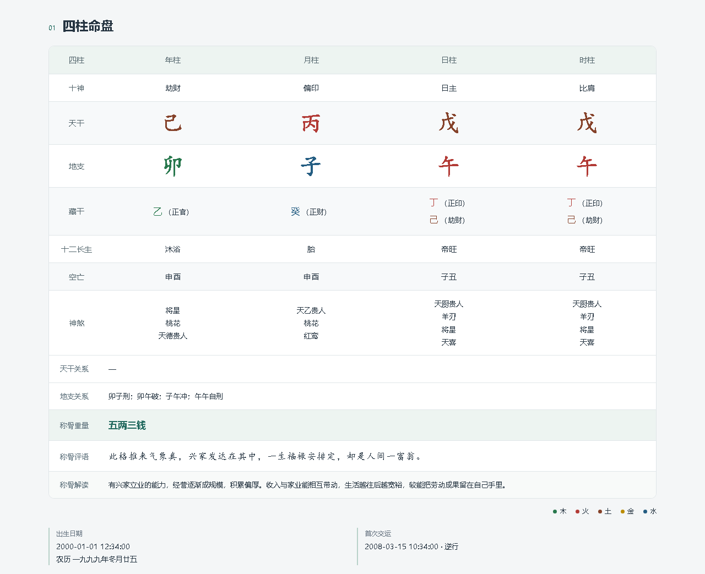
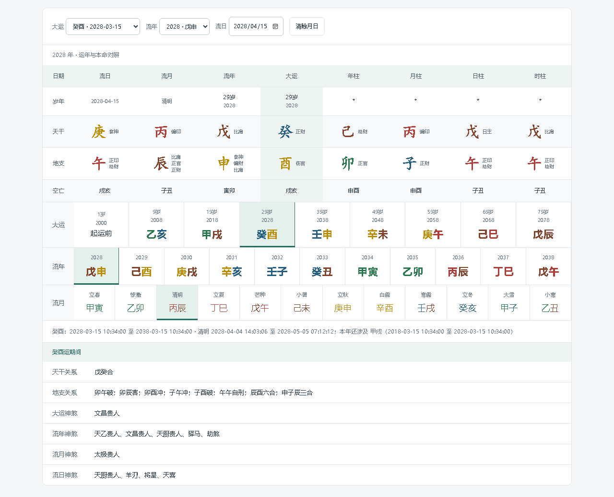
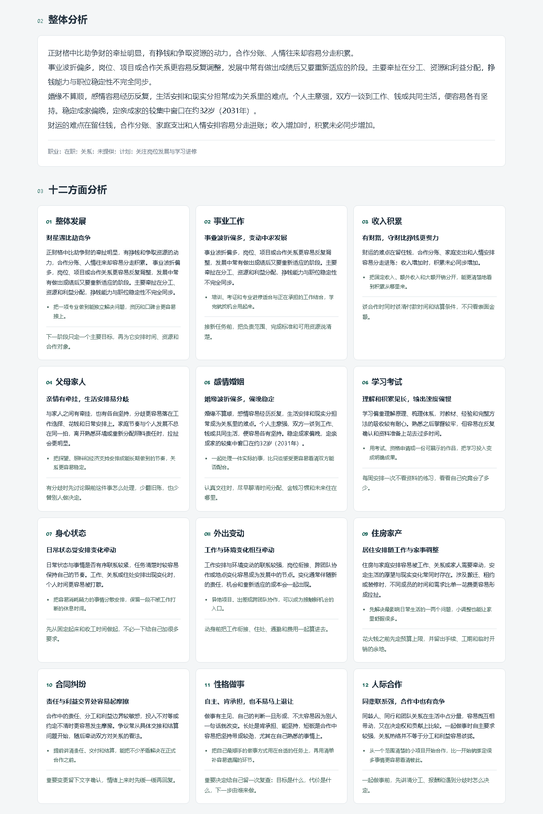
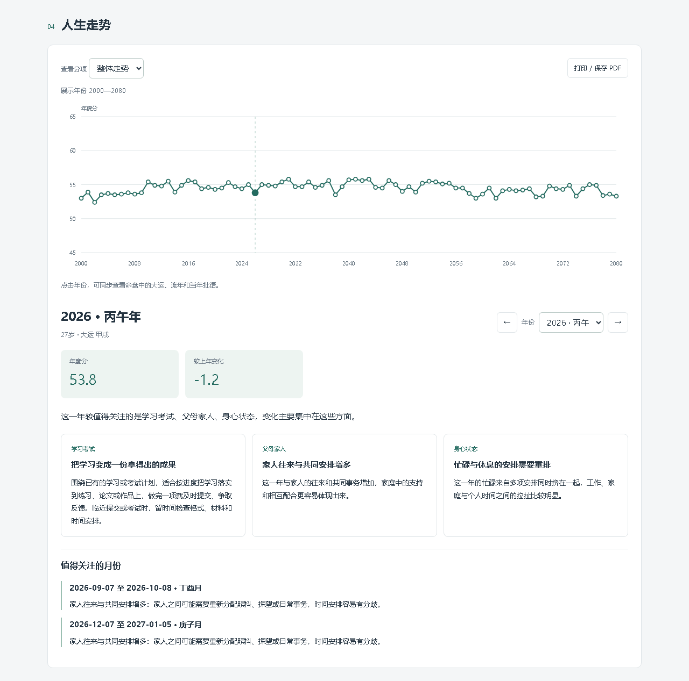
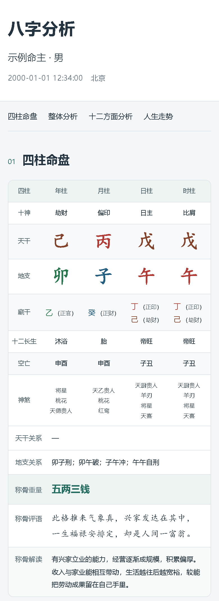

# dsh-bazi · 八字分析


给 DeepSeek Harness 使用的四柱八字插件，内置 `bazi` skill。输入出生信息或已知四柱，生成命盘、十二个人生领域的总体批语、逐年分析和人生走势图。

总评结合月令格局、透干根气、制化和夫妻宫，直接说明事业顺逆、财务积累与婚缘早晚；成家年龄只取原局和真实大运流年共同支持的成年窗口，不固定套用某个年龄。命盘沿用周易大学式表格布局和当前配色，支持运年月日联动；称骨重量、评语和直接解读并入本命盘底部。年度批语覆盖十二方面，流月只列重点月份，不逐月打分。来源和计算明细保留在原始 JSON 中。

BaZi charting and traditional interpretation for DeepSeek Harness. Accepts solar/lunar birth dates or known Four Pillars, calculates locally or via Zydx, and provides twelve-domain readings, linked luck-cycle/year/month/day views, annual trend charts, standalone HTML reports and a bundled skill.

## 快速安装

需要 Node.js 22+；面向 DSH `>=0.2.2-rc.1 <0.3.0-0`，已用官方 rc.1 组件验证。Web profile 安装：

```powershell
dsh plugin --profile web add "github:wishprophet/dshbazi#v0.1.6"
```

也可从 [v0.1.6 发布页](https://github.com/wishprophet/dshbazi/releases/tag/v0.1.6) 下载 `dsh-bazi-0.1.6.tgz`，将本地路径交给 DSH 插件管理器安装。Desktop 使用应用内插件管理或桌面自带 CLI，详见下方安装说明。

安装后可以直接说：

> 使用 bazi skill，男，出生地北京，公历 2000 年 1 月 1 日 12:34。先本地排盘，再分析整体情况和十二方面，细批 2026—2030 年，并给出人生走势。

插件提供 `bazi_reading`、`bazi_years`、`bazi_report` 三个工具和内置 `bazi` skill。交互报告由 CLI 输出，或由 `bazi_report` 返回 HTML 文本；截图展示的是可独立打开的报告。

## 实际报告截图

以下截图均由 `examples/solar.json` 中的虚构示例生成。市场截图清单为根目录的 [`screenshots.json`](screenshots.json)，[截图说明](docs/screenshots/README.md) 包含复现方法。

**四柱命盘**：天干、地支上下对齐，展示五行颜色、十神、藏干、关系和内联称骨批语。



<details>
<summary>运年月日与本命对照</summary>

选择大运、流年、节气月或具体日期，查看对应干支及其与本命的关系。



</details>

<details>
<summary>整体分析与十二方面批语</summary>

先给事业、财富、婚缘等具体判断，再展开十二方面的批语和建议。



</details>

<details>
<summary>人生走势、年度事件与重点月份</summary>

连续折线显示年度变化；选择年份后同步显示当年分析，只列值得关注的月份。



</details>

<details>
<summary>手机阅读</summary>



</details>

## 功能与来源

- **网站优先**：`auto` 尝试 [周易大学堂排盘](https://zydx.top/) 的免登录、不保存命例路径；请求失败时降级本地，在原始 JSON 中记录实际来源与原因。插件不登录账号、不操作保存命例；这不意味着第三方服务器没有请求日志。
- **本地排盘**：`local` 使用锁定版本的 [`lunar-javascript`](https://github.com/6tail/lunar-javascript)，无须把出生信息发往排盘网站。`website` 用于明确要求网站来源的场景，不能将失败伪装成网站成功。
- **十二领域**：整体发展、事业工作、收入积累、父母家人、感情婚姻、学习考试、身心状态、外出变动、住房家产、合同纠纷、性格做事、人际合作；对应的传统维度仍在内部保留。
- **逐年分析**：每年选取最突出的事情，落到岗位、回款、课程、相处、住房和出行等生活表现。用户提供的职业、婚恋和计划只用于对应年份。
- **命盘对照**：四柱、大运、流年干支按五行着色，可切换年份与大运对照；交运年保留前后两步运。公开报告不显示纳音。
- **称骨批语**：按通行农历年月日时权重表计算，显示歌诀原句与原创白话。仅有四柱时不猜出生日期和骨重。
- **人生走势**：从出生年起展示八十年的连续折线，指定更远结束年时延展；同时保留请求的细批区间。图表结束年份是固定展示范围。内部 OHLC、流月数据与计算明细完整保留。
- **报告文件**：Markdown 和可独立打开的 HTML 用于阅读，JSON 用于取数、复核和继续分析。

## 本地试用

需要 Node.js 22 或更高版本。在项目目录执行：

```powershell
npm ci
npm test
npm run demo
```

`demo` 使用虚构案例与本地计算。输出位于 `reports/example/`：

| 文件 | 内容 |
|---|---|
| `chart.json` | 规范化命盘 |
| `report.json` | 完整结构化报告与来源 |
| `report.md` | 总评、十二领域和逐年生活批语 |
| `report.html` | 可读命盘报告与年度连续折线图 |

使用自己的输入文件：

```powershell
node src/cli.js --input examples/solar.json --provider auto --out reports/my-reading
```

也可以直接传入参数：

```powershell
node src/cli.js --date 1990-06-15 --time 09:30 --calendar solar --gender male --name "示例甲" --location "重庆" --provider local --out reports/my-reading
```

已知四柱可以直接输入：

```powershell
node src/cli.js --pillars "甲子 丙寅 戊辰 庚申" --gender male --birth-year 1984 --provider local --out reports/pillars
```

出生年份仅用于年龄定位，不能代替起运日期。若已有核实后的起运日期，可传 `--start-luck-date YYYY-MM-DD`；**缺起运资料时不伪造完整大运及交运年龄**。

## 输入说明

下面展示工具/API 的数据形状，案例不对应实际人物：

```json
{
  "name": "示例甲",
  "gender": "male",
  "location": "重庆",
  "calendar": "solar",
  "date": "1990-06-15",
  "time": "09:30",
  "startYear": 2026,
  "endYear": 2035,
  "context": {
    "occupation": "企业项目管理",
    "relationship": "已婚",
    "plans": "考虑内部竞聘，暂无搬迁计划"
  }
}
```

- `name` 为姓名或称呼，`location` 为出生地点。地点文本不能自动证明已换算真太阳时。
- `calendar` 为 `solar`（公历）、`lunar`（农历）或 `pillars`（已知四柱）。农历闰月用 `leapMonth: true`；日期为所选历法中的年月日。
- `time` 为 `HH:mm`。当前以中国标准时间处理；海外出生、夏令时、真太阳时或换日口径需先核实，不能直接当作已经支持。
- `gender` 为 `male` 或 `female`，用于传统顺逆排运参数。
- `pillars` 模式传 `{ "year": "甲子", "month": "丙寅", "day": "戊辰", "hour": "庚申" }`，不从四柱猜造唯一出生日期。
- `context` 只写实际情况；没有提供就留空。模型不能把背景事实冒充预言命中。
- 背景只适用于 `contextYear` 当年；省略时默认北京时间当年。复盘旧事可指定当时年份，不把当前职业或婚恋状态沿用到相邻年份或整个人生。
- `startYear`、`endYear` 控制流年报告范围。首次可先细批近期十年，避免将大量年份一次送入模型上下文。

## 安装到 DeepSeek Harness

本项目是 Cordis 插件 bundle，注册 `bazi_reading`、`bazi_years`、`bazi_report` 和一个内置 `bazi` skill。无需修改 DSH 核心，也无需重复复制 skill 到用户目录。

插件声明面向 DSH `>=0.2.2-rc.1 <0.3.0-0` API。这个范围是开发目标，**不等于每个版本均已在真实运行环境验证**。实现参考当前官方 `ToolDefinition` 与 skill registry；安装前用实际 DSH 的 `--version` 核对，不绕过不兼容版本检查。

### Web profile 本地安装

在已经可用的 DSH CLI 中执行（路径换成实际项目绝对路径）：

```powershell
dsh --version
dsh plugin --profile web add "F:/Program/dsh/bazi"
```

如果通过 npm 启动 Web，可用同版本的 npm CLI：

```powershell
npx @deepseek-ai/dsh plugin --profile web add "F:/Program/dsh/bazi"
```

也可在 DSH 的插件管理工具中执行 `install_bundle`，将 `target` 设为项目的绝对目录。由 Plugin Manager 管理 profile 变更，不手工修改 profile 的 `package.json`。

### Desktop 安装

优先使用桌面应用内的插件管理入口，或让当前 DSH 会话调用 `plugin_manager` 的 `install_bundle` 安装本地目录。若使用命令行，必须使用**桌面安装自带的 dsh 命令运行时**：

```powershell
dsh plugin --profile desktop add "F:/Program/dsh/bazi"
```

普通 npm 安装的 DSH CLI 不支持管理 `desktop` profile。若安装结果提示 `restart-required`，重启对应 DSH 实例后再验证。来源见 [官方 CLI 文档](https://github.com/deepseek-ai/deepseek-harness/blob/master/apps/cli/README.md) 和 [Plugin Manager 文档](https://github.com/deepseek-ai/deepseek-harness/blob/master/packages/boot/plugin-manager/README.md)。

### GitHub 安装

源码仓库：[wishprophet/dshbazi](https://github.com/wishprophet/dshbazi)。仓库名为 `dshbazi`，插件包名为 `dsh-bazi`，本地目录可继续叫 `bazi`。安装 0.1.6：

```powershell
dsh plugin --profile web add "github:wishprophet/dshbazi#v0.1.6"
```

也可把 `v0.1.6` 换为完整提交 SHA，以固定实际代码。若仓库为私有，运行 DSH 的机器也需要仓库读取权限；仅在开发机添加 SSH 公钥不会自动给其他服务器授权。无法直接读取时，将安装包复制到 DSH 服务器后从本地安装。Desktop 同样使用应用内插件管理或其自带 CLI。

安装后向 DSH 发送：

> 使用 bazi skill，姓名示例甲，男，出生地重庆，公历 1990 年 6 月 15 日 09:30。先用本地算法排盘，再讲整体情况、十二个人生领域，细批 2026—2030 年。2026 年在做企业项目管理，已婚，正在考虑内部竞聘。请用普通人读得懂的话，讲清各年主要事情，最后给人生走势图。

`bazi_reading` 返回 `reportId` 和紧凑排盘摘要、十二维度、逐年一行概览及最多五年情景预览；原始完整报告保留在进程内缓存，最多八份、有效一小时。后续使用：

```text
bazi_years({reportId, startYear: 2026, endYear: 2030})
bazi_report({reportId, format: "html"})
```

`bazi_years` 每批最多十年，返回具体情景、依据和流月简表。报告 ID 对应同一命盘，不采用“最新命盘”隐式替换；过期、淘汰或重启后需重新排盘。不会将几十年全部计分明细写入 DSH 会话上下文。

`bazi_report` 把缓存原报告渲染为 HTML/Markdown **文本**，仅在需要完整报告时调用；它不写文件，也不保证 DSH 会自动预览任意 HTML。完整文件输出使用本项目 CLI；当前不含原生 DSH Client 仪表盘。

也可仅使用本项目的 `skills/bazi` skill 加 CLI，而不加载插件：模型运行 CLI 后按需读取 JSON 和文字报告。此方式仍需完整项目及其依赖，单独一份 SKILL.md 不包含历法引擎。

## 报告怎么看

报告先展示本命表格及紧接称骨评语的一行解读，再通过运年表对照大运、流年与月日。后面是总评、十二方面批语和人生走势。正文不要求读者理解“格局候选”、规则编号、计算口径或算法版本，也不附成套条件列表。只有缺少资料或实质冲突影响结果时，才简短说明还需补什么。

人生走势图使用年度连续折线，与报告中的年度分数一致。原始 JSON 仍保留完整盘面、来源、证据、内部提醒、OHLC 和月度数据；如果专门追问依据，可以继续从这些资料中展开。

接手项目先看 [交接文档](docs/HANDOFF.md)。开发说明见 [docs/integration.md](docs/integration.md)，已执行的检查及边界见 [docs/validation.md](docs/validation.md)。发布步骤见 [docs/publishing.md](docs/publishing.md)，市场资料维护见 [docs/MARKETPLACE.md](docs/MARKETPLACE.md)，版本变化见 [CHANGELOG.md](CHANGELOG.md)。
